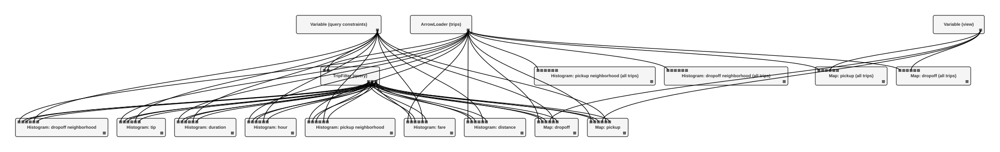

# Progressive TaxiVis on VisTrailsJL

A Julia port of the progressive TaxiVis built on ProgressiVis
(`progressivis-parallel/taxivis`), itself a simplified TaxiVis (Ferreira et
al., "Visual Exploration of Big Spatio-Temporal Urban Data: A Study of New
York City Taxi Trips", TVCG 2013). Same data, same queries, same page and
HTTP API; the dataflow is a VisTrailsJL `Pipeline` run by the
`ProgressiveEngine` (`docs/EXECUTION.md`). Up to three colored queries
select trips by pickup and dropoff region (rectangles or neighborhoods),
days of the week, hours of the day and attribute ranges; every view updates
while the trips stream in (14.8 million for January 2013, 173 million for
the year), and every interaction restarts a progressive computation instead
of blocking.

Beyond ProgressiVis' version: **loading stops once the displays converge**.
Trips arrive in random (or stratified) order, so what has been read is a
sample: counts are shown as estimates for all trips, and the loader reads
only while some display could still visibly change (see
[Accuracy](#accuracy)). On the year, that is 18% of the trips until a
query or a zoom needs more.

## Requirements

- The FOIL 2013 data, locally (default `~/data/FOIL2013`, or set
  `FOIL2013`): for January, TaxiVis' preprocessed `processed/2013_01.kdtrip`;
  for the year, the raw `Tripdata_2013/trip_data_M.csv` and
  `Faredata_2013/trip_fare_M.csv`. Nothing is downloaded.
- A web browser. The page uses no external libraries or map tiles.

## Running

From the repository root:

```sh
# once: write julia/examples/taxivis/data/taxivis_2013_01_stratified.arrow (874 MB)
julia --project=julia --threads=auto julia/examples/taxivis/prepare_data.jl

# or the whole year from the raw CSVs (Tripdata_2013, Faredata_2013):
# data/taxivis_2013_random.arrow, 173 M trips in random order (10.7 GB, ~9 min, 10 GB of memory)
julia --project=julia --threads=auto julia/examples/taxivis/prepare_data.jl --year

# start the dataflow and the local server (add --year for the year)
julia --project=julia --threads=auto julia/examples/taxivis/app.jl --year

# then open
open http://127.0.0.1:8767/
```

The server listens on 127.0.0.1 only; Ctrl-C stops it. To watch loading
arrive, use `--rate 250000` (rows per second). Individual observations
on 8 threads, not a benchmark:

- **Year** (default accuracy): displays converged after 31.5 M trips
  (18%), 7 s after start, 5.5 GB resident. Financial District pickups on
  weekend nights: first results 0.24 s, estimate within 1% after about 5 s;
  the query's maps then needed all trips (loading resumed; complete in
  51 s). A zoom: first results 0.43 s, complete in 45 s.
- **January**, `--accuracy 0` (every trip): loads in about 3 s, complete
  about 10 s after start; the query above completes in about 4 s.

Options of `app.jl`:

| Option | Default | Meaning |
| --- | --- | --- |
| `--year` | off | the year (`prepare_data.jl --year`), else January |
| `--accuracy A` | 0.99 | share of each display's trips that must be in stable bins; 0: read every trip |
| `--tolerance T` | 3 | color levels (maps) or pixels (charts) a stable bin may still move (95% interval) |
| `--workers N` | threads | `ProgressiveEngine` workers |
| `--port P` | 8767 | HTTP port |
| `--bins B` | 512 | map resolution (B x B) |
| `--rate R` | off | load at most R rows per second, to watch loading (250000: about 1 minute for the month) |
| `--throttle R` | off | at most R rows per loader step |
| `--rows N` | all | use the N-row file written by `prepare_data.jl --rows N` |

The page (`static/index.html`, `static/client.js`) is ProgressiVis' page,
with the period (January or the year: daily points, computed weekends,
month ticks) and the status of a converged run (counts shown as `≈`); see
ProgressiVis' README for how to use it.

## Accuracy

Each `TripHistogram` knows how the page draws it, and reports
`converged` (the engine's hook, `docs/EXECUTION.md`, "Convergence") once
more trips could not visibly change it:

- counts from `n` of `N` trips are a simple random sample: a bin with
  count `c` has relative error √((1 − n/N)/c) (0 once every trip was read);
- maps and neighborhoods are drawn in log scale: a bin is stable when its
  95% interval moves its color by at most `tolerance` levels; charts are
  linear: a drawn point (a day, for the year's time series) is stable when
  its height moves by at most `tolerance` pixels;
- a display has converged when `accuracy` of its trips are in stable bins.

What is not shown has converged: disabled queries, and maps of the end not
shown in the current mode (Pickups, Dropoffs, Both). The engine then stops
the loader; a query, a zoom or a mode change that unsettles a display
resumes it. Measured on the year (all-trips pickup map, 99% stable):
tolerance 1 needs 65% of the trips, 2: 30%, 3: 17%, 4: 10%.

## Dataflow



*The pipeline as `build_dataflow` creates it, drawn by VisTrailsJL's workflow
renderer (`render_pipeline.jl`; one query shown, queries 2 and 3 are
copies). Top: the constraints `Variable` of the query, the `ArrowLoader`,
and the view `Variable` (bounds and mode). Middle: the query's `TripFilter`
and the four summaries of all trips. Bottom: the query's nine summaries
(maps, five attributes, neighborhoods). Every summary reads the loader's
table; a query's summaries also read its filter's selection, revision and
progress, and its constraints (to know whether the query is enabled); maps
also read the view.*

39 modules in all: the loader, the view and three constraints `Variable`s,
3 filters, 8 map, 15 attribute and 8 neighborhood histograms. Regenerate
the figure after changing the dataflow:

```sh
julia --project=julia julia/examples/taxivis/render_pipeline.jl
```

- `ArrowLoader` (package `progressive`) appends the memory-mapped rows of
  the Arrow file to a `ProgressiveTable`, in stratified (January) or random
  (year) order, so every prefix is a sample spread over time and place; it
  pauses while no display needs more trips.
- A query edit validates the request (`normalize_query`), then
  `set_variable!` sets the query's constraints `Variable`; this gives the
  filter and its histograms interactive priority.
- `TripFilter` (package `taxivis`) tests chunks of rows against all of a
  query's constraints and appends the ids of matching trips to its
  selection; when its constraints change, it empties the selection, bumps
  its `revision` output and rescans from the first trip.
- `TripHistogram` counts the values of its selection (read with `gather`)
  or of all trips, and after every step publishes an immutable `Summary`
  tagged with the query revision it counts and whether it converged; map
  histograms rebin when the view bounds change.
- The server (`server.jl`) reads summaries for `/state` and `/map.png`, and
  reports a query or the view as ready when every summary it needs carries
  the current revision.

## Files

| File | Purpose |
| --- | --- |
| `prepare_data.jl` | January in stratified order to Arrow (same rows, order and columns as ProgressiVis' `prepare_data.py`); `--year`: the whole year from the CSVs, in random order |
| `regions.jl` | reads the neighborhoods; neighborhood of points by ray casting (same arithmetic as `regions.py`) |
| `data/neighborhoods.txt` | 132 NYC neighborhoods, from TaxiVis (Copyright (c) 2013-2015, New York University, BSD license) |
| `dataflow.jl` | query validation, `TripFilter` and `TripHistogram` modules, the pipeline |
| `server.jl` | application state, `/state` snapshot, map rendering (PNG), HTTP routes |
| `TaxiVis.jl` | the example as a module (`include` it, then `using .TaxiVis`) |
| `render_pipeline.jl`, `pipeline.svg` | draws the dataflow with VisTrailsJL's workflow renderer |
| `app.jl` | command-line entry point |
| `static/` | the page, from ProgressiVis |

Endpoints, request and response JSON are those of ProgressiVis' `app.py`:
`GET /`, `/client.js`, `/state`, `/map.png`, `/regions`, `/debug`,
`POST /query`, `POST /view`. Invalid requests return JSON errors with HTTP
400.

## Validation

The January Arrow file matches ProgressiVis' Parquet file column by column
(SHA-256 of every column); the year's CSV path gives exactly the same
January values (every column equal as a multiset). Financial District
pickups on weekend nights (Sat and Sun, 22-2 h) count 11,658 trips in
January with `--accuracy 0`, as NumPy counts over the Parquet file. The
page was checked in a browser for January before the accuracy changes.

## Limits

- Map histograms bin about 3 M trips per second each: a zoom on the year
  rescans the loaded trips (45 s to complete; first results in under 0.5 s).
- Neighborhood histograms are computed even when that layer is hidden
  (the page's layer is not sent to the server).
- No automated tests for the example itself (the engine's convergence,
  `ArrowLoader` and `gather` are tested in `test/progressive/`).
